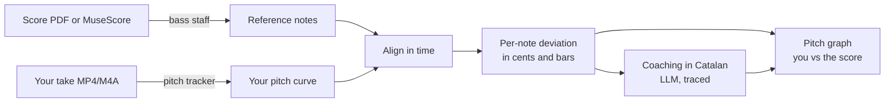

# Doremi development plan

Last updated: 2026-10-28

The build order for Doremi, the choir voice coach. Each phase ends in a check that proves it works before the next phase starts. How agents do the work (plan-first branches, PR gates, autonomy tiers) is in [SDLC.md](SDLC.md).

## Where we are

| Done | Notes |
|---|---|
| Agent process and guardrails | Plan gate, risk tiers, secret scan, guard hook, owner-approved deploy |
| Coaching pipeline traced in Langfuse | PR #1: lyrics transcription and coaching via OpenRouter, about $0.0002 a take |
| Choir material catalogued | 14 songs, 13 with a bass practice track, kept locally outside the repo |
| Bass staff located in the scores | Label Bajo / Baix / B, normally the 4th staff. La Barraqueta has 3 staves, bass on the 3rd ("Tenors i Baixos") |
| Coaching language | Catalan, in tones and bars: "mig to baix al compàs 12" |
| Pilot songs | *Gallo rojo, gallo negro* (clean score, bass-only audio mix) and *Què volen aquesta gent?* (MuseScore file) |

## How it works, end to end

The LLM only writes the coaching words. Pitch, timing and the score come from deterministic code, so the graph is never a guess.

## Who builds it

Phases 1 to 5 are built by the coding agent in GitHub Actions, one issue per phase, labelled `phase`. Adding the `agent:ready` label starts Claude Code (`.github/workflows/agent.yml`) with the instructions in `.github/agent-prompt.md`. It opens a PR through the normal gates, and the PR closes the issue when it merges. `agent-chain.yml` then labels the next phase. Progress shows on the Project board. Phase 6 is labelled `human` and is never picked up by the agent.

The agent pushes as the `doremi-code-agent` GitHub App. The App has no workflow permission, so it can't edit `.github/workflows/`.

## Phases

### Phase 0. Unblock the pipeline

Done 2026-10-28 (PR #4). The checks run real work, `main` has a ruleset with 7 required checks and no bypass, and auto-merge is on. The eval and Playwright checks skip with a notice until phases 4 and 5.

### Phase 1. Reference notes from the score

Turn the bass staff into a list of notes: pitch, start beat, length, bar number and lyric syllable.

- Read MuseScore files directly (`.mscz` is zipped XML) and MusicXML.
- Pick the staff labelled Bajo / Baix / B, normally the 4th. Three-staff scores (*La Barraqueta*, *Ay Carmela*) put tenors and basses on the 3rd staff, in bass clef.
- The agent builds and tests this on small SATB fixtures it writes itself. The choir's own songs are read on the owner's laptop and never committed.

**Exit check:** the parser returns exactly the bass notes of the fixtures. On the owner's laptop, *Gallo rojo* read from its PDF matches the bass-only mix `gallo_B_2.3.mp3` in at least 95% of beats.

### Phase 2. Pitch tracking

Measure the sung pitch about 100 times a second.

- Use CREPE, the tracker OnKey uses in a shipped app. Start in Python, which is easiest to test.
- Read any format the choir uses (MP4, M4A, OGG, MP3) through ffmpeg.
- Mark silence and breaths so they don't count as wrong notes.

**Exit check:** on synthetic test audio generated from the score (known notes, known pitch), the median error is under 10 cents. The test audio is made by the code, so no choir recording enters the repo.

### Phase 3. Alignment and scoring

Line up your take with the score, then measure each note.

- Align with dynamic time warping, so singing slightly early or late isn't scored as wrong notes.
- Per note: deviation in cents, early or late, held too short.
- Forgiving rules, as in OnKey: an octave off counts as correct, small timing slips aren't penalised.
- Per bar: a score from 0 to 100.

**Exit check:** on a synthetic take that is 30 cents flat in bar 4 only, Doremi flags bar 4 and nothing else. This is the `choir-part-accuracy` check from SDLC.md.

### Phase 4. Coaching in Catalan

Turn the numbers into two or three concrete tips.

- Input to the LLM: the per-bar deviations, the bar numbers and the lyric syllables. Never the raw audio.
- Vocabulary from the choir's theory notes: *to, semitò, compàs, piano, forte, crescendo*.
- Traced in Langfuse (already in place), checked with promptfoo for language, bar references and no invented notes.

**Exit check:** on 10 synthetic takes with known mistakes, every tip names the right bar, and none mentions a bar that was sung well.

### Phase 5. The practice page

The screen you use after singing.

- Your pitch line over the score's line, bar numbers along the bottom, off-pitch stretches marked.
- Click any point to hear your take from there, or the score's notes played from the same point (A/B).
- The Catalan tips beside the graph, each linked to its bar.
- Upload a take, or record it in the browser.

**Exit check:** the Playwright validator uploads a take, clicks the graph, plays A and B, and sees no console errors. These are the `ux-validator` and evidence screenshots from SDLC.md.

### Phase 6. Deploy

- Page and API on Cloudflare Workers. Sessions, scores and the weekly cost counter go in a Durable Object.
- Pitch tracking runs on a small Python server with full CREPE, so the phone runs no model (owner decision, 2026-10-28). Workers can't run Python, so the Worker sends the take to this server. The host is still to pick.
- Recordings stay private. The €50 a week hard stop lives in the Worker and covers the server's cost too.

**Exit check:** you sing *Gallo rojo* from your phone and get the graph and tips in under 5 seconds.

### Phase 7. All the songs

- No MuseScore sources exist beyond *Què volen* and *La Barraqueta*, so Audiveris (open-source score reading) reads every other PDF to MusicXML. Scans (L'Internacional, Soldado) need a check by eye.
- Songs with no score (Rosa de paper, Ya Tale3in): convert the bass practice track to notes as a last resort, marked as lower confidence.
- Each new song adds its fixture to the `song-regression` check, so adding songs can't break old ones.

**Exit check:** every song with a bass part has a reference, and `song-regression` is green.

## Choir material stays private

The repo is public. The choir's recordings, scores, arrangements and the note data read from them stay on the owner's laptop in `Desktop/claude/doremi-data/`. Tests use audio generated from code, or public-domain songs. The guard hook and `.gitignore` already keep `recordings/` out.

## Open questions

| Question | Who | Blocks |
|---|---|---|
| Which host runs the Python CREPE server? | Owner | Phase 6 |

Answered on 2026-10-28: pitch tracking runs on a server, not in the browser. The director has no more MuseScore sources. *Ay Carmela* has no staff labels; it's 3 staves and the bass line is the bass-clef 3rd staff, shared with the tenors.
