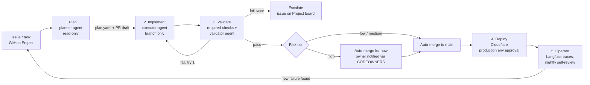
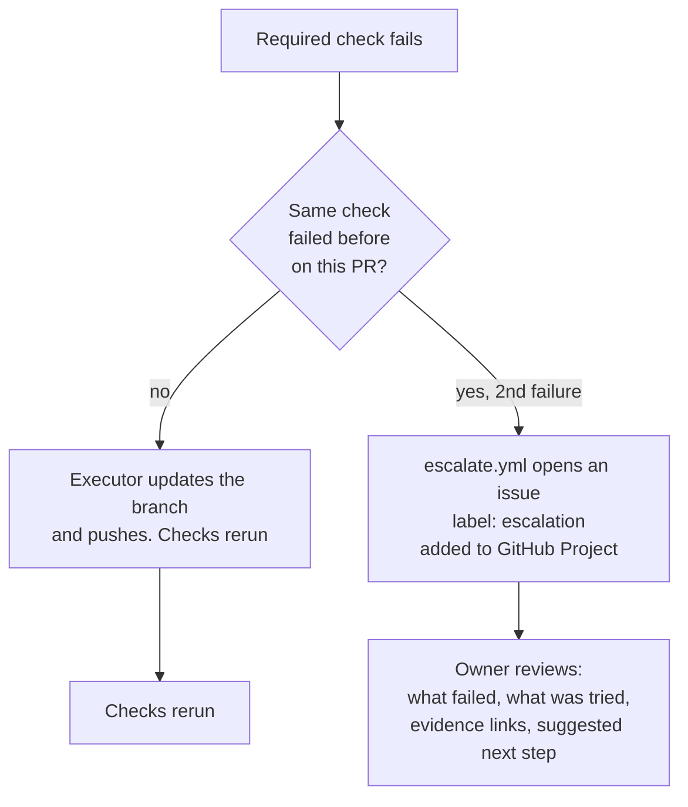
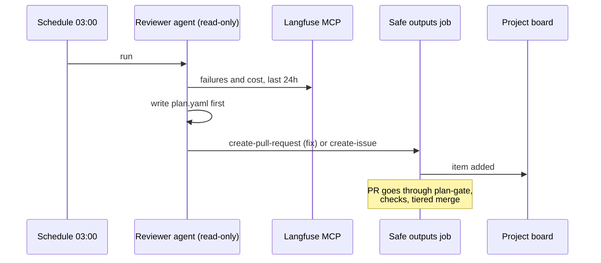

# Doremi: agent SDLC

A worked example of the Microsoft Learn module *Designing Agent Architecture and SDLC Integration*, applied to one small app.

**The app.** Upload a recording of yourself singing your choir part (MP4) plus the sheet music (PDF). The app shows your pitch curve on top of the pitch curve you should have sung, note by note. Click any point to hear what you sang and what you should have sung at that moment, and read what to fix.

**Who it is for.** One user, the owner, who sings in a choir. A choir part is not the song's main melody, so "the song" from YouTube is not the reference. The reference is the part on the sheet music.

---

## 1. Stages at a glance



| Stage | Who acts | Input | Output (artifact) | Exit gate |
|---|---|---|---|---|
| 1. Plan | Planner agent, read-only tools | Issue, PDF, MP4, constraints | `.agent/plans/<branch>.yaml` + PR body "Plan" section | `plan-gate` check passes |
| 2. Implement | Executor agent, write tools on its own branch | Approved plan | Commits on `agent/<issue>-<slug>`, PR | Diff stays inside the plan's `scope.paths` |
| 3. Validate | CI + validator agent (Playwright) | PR head commit | Check results, Playwright trace, eval report, uploaded as artifacts | All required checks green |
| 4. Deploy | Deploy workflow, `production` environment | Merged commit SHA | Cloudflare deployment pinned to that SHA | Owner approves the environment |
| 5. Operate | Nightly reviewer agent | Langfuse traces, cost, errors | Issues or fix PRs (never direct changes) | Back to stage 1 |

Branches. `main` is the integration branch. `production` is not a branch you push to: production is whatever SHA the deploy workflow last shipped, so rollback means redeploying an older SHA. Agents only ever write to `agent/*` branches.

---

## 2. Scope and success criteria

### Plan scope (two steps)

1. **Capture.** Record or upload a voice note. Extract the sung pitch per frame and the words.
2. **Feedback.** Compare against the reference part. Show the whole recording as a graph: your curve, the target curve, and highlighted segments where you were flat, sharp, early, or late. Give a score per phrase and a short list of what to work on.

A note on step 1. An LLM does not measure pitch well. Pitch comes from a signal-processing model (for example `basic-pitch` or `pYIN`/`CREPE`). The LLM does the parts it is good at. It transcribes lyrics to align phrases, and it turns the numeric diff into plain-language coaching. This keeps cost and latency down and makes the graph trustworthy.

### Success criteria (measurable)

| Criterion | Metric | Target | Where it is measured |
|---|---|---|---|
| I can see where I was off and why | Every phrase scored, every deviation over 50 cents highlighted with a timestamp | 100% of phrases | Validator agent + eval fixtures |
| The app is useful | Sessions per week by the owner | 3 or more (more than 2) | Langfuse sessions |
| Recordings never break | Upload or processing errors | 0 per week | Langfuse + Worker logs |
| LLM responds fast | Feedback latency, p95, upload end to first feedback | Under 5 s (pitch graph under 2 s) | Langfuse latency |
| Budget | Total LLM + infra spend | Under €50 per week, hard stop at €50 | Cost counter in the Worker + Langfuse cost |
| Adding songs does not break anything | Regression suite over all songs in the library | 0 regressions | `song-regression` check |

---

## 3. Agents and responsibilities

One responsibility per agent. Planning and execution are separate agents with separate tool sets, so the reviewer can read the intent before reading the diff.

| Agent | Responsibility | Tools allowed | Tools denied |
|---|---|---|---|
| Planner | Turn an issue or a new recording into a plan | Read repo, GitHub read, Langfuse read, Playwright read | Edit, Write, Bash writes, deploy |
| Executor | Implement exactly the approved plan on its branch | Edit/Write inside `scope.paths`, tests, `git push` to `agent/*` | `recordings/`, `config/budget.yaml`, deploy, merge |
| Validator | Use the app like the user and prove the criteria | Playwright MCP, read artifacts, read recordings | Any write to the repo |
| Nightly reviewer | Read yesterday's failures in Langfuse and open issues or fix PRs | Langfuse read, GitHub safe outputs only | Direct pushes, budget, recordings |

### Inputs and outputs per task

**Inputs.**

* `score.pdf`. Sheet music. Converted to MusicXML by open-source OMR (Audiveris). The user picks which part (soprano, alto, tenor, bass). This is the reference for a choir part.
* `take.mp4`. Voice only, no accompaniment. Audio is extracted with ffmpeg.
* Constraints. No backing track exists. If no PDF is available, the agent may look up the song on YouTube to *identify* it, but must say in the plan that the reference is then the main melody, not the choir part, and mark confidence low. Downloading YouTube audio is against YouTube's terms, so the fallback is a reference file the owner supplies.

**Output.** An interactive evaluation page:

* Your pitch curve over the target curve (peaks and valleys), with time on X and note on Y.
* Click a point to play your take from there, and to play the target (synthesized from MusicXML) from the same point. Toggle A/B.
* Per-phrase score and two or three coaching notes.

### Plan before action

Every agent run starts by writing the plan file. Nothing is changed before the plan exists. The plan says what it will do, why, and which files it will touch. See [.agent/plans/TEMPLATE.yaml](../.agent/plans/TEMPLATE.yaml). Example for "add a new song":

```yaml
intent: Add "Ave Verum Corpus" (alto part) to the song library
why: Owner uploaded score.pdf and take-01.mp4 for rehearsal on 2026-11-02
changes:
  - path: songs/ave-verum/reference.musicxml   # generated from score.pdf
  - path: songs/ave-verum/meta.yaml            # part, key, tempo
  - path: tests/songs/ave-verum.spec.ts        # regression fixture
not_touched: [recordings/, config/budget.yaml]
```

---

## 4. Validation

Validation is evidence that the outcome meets the success criteria. It runs as required checks on every PR.

| Check | What it proves | Tool (free or cheap) |
|---|---|---|
| `plan-gate` | A valid plan exists, the diff stays inside its scope, no forbidden path touched | Bash + `yq`, in Actions |
| `risk-tier` | Computes low/medium/high from changed paths, labels the PR | Bash, in Actions |
| `unit` | Pitch extraction and alignment code is correct | Vitest / pytest |
| `audio-quality` | Fixture recordings pass a quality gate (signal-to-noise, clipping, sample rate, silence ratio) | ffmpeg `astats` |
| `llm-understands` | The LLM transcribes the fixture lyrics (word error rate under 15%) | promptfoo (open source) |
| `reference-available` | Every song has a parsed reference part. Replaces "the LLM knows the symphony": the reference comes from the score, not from model memory | Script over `songs/` |
| `choir-part-accuracy` | On a fixture where the singer is known to be 30 cents flat in bar 4, the app flags bar 4 and nothing else | pytest with golden files |
| `song-regression` | All existing songs still score the same on their fixtures after the change | pytest |
| `ux-validator` | The validator agent opens the preview deploy, uploads a take, clicks the graph, plays A/B, checks no console errors | Playwright |

Playwright traces, eval reports and the pitch graph PNG are uploaded as workflow artifacts and linked in the PR "Evidence" section.

### Iterate on failure



The nightly reviewer runs while the owner sleeps. It reads Langfuse failures and opens fix PRs that go through the same gates. It never touches `recordings/` (history) or `config/budget.yaml`. A hook and the `plan-gate` check both enforce that, so a mistaken instruction cannot bypass it.

---

## 5. Pull request governance

PRs are the control point. Flow:

1. Agent creates `agent/<issue>-<slug>`.
2. Agent opens a PR whose body has the Plan section ([template](../.github/pull_request_template.md)).
3. `plan-gate` validates the plan. Under Option B (plan and execution in one PR) the code is generated immediately, but the PR cannot merge until the plan is valid and every check passes.
4. GitHub Actions run the required checks.
5. All green, so auto-merge. The merge mode per tier comes from `merge:` in the policy file. Today every tier is `auto`.

Plan and diff are separate commits. The first commit on every agent branch is only the plan file. The reviewer (or the owner reading the Project board) opens that commit to see intent, and the rest of the commits to see execution. That is the plan/execution separation mapped into GitHub, without a second PR.

### Autonomy tiers

Defined in [.github/agent-policy.yml](../.github/agent-policy.yml). `risk-tier` reads that file, so the policy and the enforcement cannot drift.

| Tier | Examples | Merge |
|---|---|---|
| Low | `docs/`, generated graphs, report artifacts | Auto-merge after checks |
| Medium | `src/`, dependency bumps, new songs in `songs/` (already-approved content) | Auto-merge after checks |
| High | `.github/workflows/`, `.github/agent-policy.yml`, LLM model or prompt config, `infra/`, `wrangler.toml`, `.mcp.json`, hooks | Auto-merge after checks for now, owner notified (CODEOWNERS). Switch `merge.high` to `owner-review` if issues show up |
| Critical | Production deploy, secrets, budget | Agent prepares, cannot execute. `production` environment requires owner approval |
| Forbidden | `recordings/`, `config/budget.yaml` | Agent PR fails `plan-gate` |

Changing the LLM model is High, not Medium. A model swap changes cost, latency and feedback quality at once.

### Reliable workflows

* **Defensive gating.** Every PR-only job has `if: github.event_name == 'pull_request'`, so a manual or scheduled trigger cannot run PR logic without a PR.
* **Outputs are contracts.** `risk-tier` publishes `tier` as a job output. `automerge` reads `needs.risk.outputs.tier`. Nothing parses logs.
* **Least privilege.** Every workflow starts at `permissions: contents: read` and elevates per job.
* **Pinned deploys.** Deploy takes a commit SHA, never "latest on main". Rollback is "deploy the previous SHA".

---

## 6. Deploy (Cloudflare)

* Worker + static assets on Cloudflare. Durable Object with SQLite for sessions, scores and the weekly cost counter (the current Cloudflare token is Workers-only, so D1/KV/R2 are out).
* Recordings stored in the Durable Object or a Supabase bucket, append-only.
* PR previews deploy to a preview Worker. The validator agent tests the preview, not production.
* Production deploy is [.github/workflows/deploy.yml](../.github/workflows/deploy.yml) with `environment: production`. The owner is the required reviewer. The Cloudflare token only exists in that environment's secrets, so no other job can see it.

---

## 7. Operate: observability, tools, guardrails

### Evidence for every action

Each agent action leaves a GitHub-native artifact. Each artifact names the run ID and commit SHA it came from.

| Action | Evidence |
|---|---|
| Plan | Plan commit + PR body |
| Code change | Commits on the agent branch |
| Check | Workflow run link + uploaded report |
| UX validation | Playwright trace + screenshot of the pitch graph |
| LLM call | Langfuse trace (latency, cost, prompt version) |
| Tool call | Hook audit log line (`.agent/audit/*.jsonl`, uploaded as artifact) |
| Escalation | Issue on the Project board |

### GitHub Project as the manager's view

One Project board, "Doremi". Columns: Backlog, Planning, In PR, Escalated, Shipped. Every agent issue and PR is added automatically ([escalate.yml](../.github/workflows/escalate.yml) adds escalations). The owner manages from the board and does not read diffs unless something is escalated.

### MCP servers (allowlist)

[.mcp.json](../.mcp.json) is the allowlist. Only these servers exist for the agent. Anything else is blocked by the hook.

| Server | Transport | Used by | Tools exposed |
|---|---|---|---|
| `github` | Remote HTTP | Planner, executor | Issues, PRs, read contents |
| `playwright` | Local stdio | Validator | Browser navigate, click, screenshot |
| `langfuse` | Remote HTTP, hosted on Cloudflare | Planner, nightly reviewer | Read traces, read scores (read-only) |

A custom MCP server (the Langfuse wrapper, or a `songs` server exposing the library) runs as a Cloudflare Worker using `McpAgent`. Writes never go through MCP. They go through PRs. A private MCP registry is not worth it for one developer. Revisit it when a second person joins.

Secrets are never in the repo. Tokens arrive as environment variables at runtime. In Actions they are scoped per environment.

### Hooks

Hooks run outside the model's reasoning, so they hold even when an instruction is wrong. Configured in [.claude/settings.json](../.claude/settings.json), script in [.claude/hooks/guard.sh](../.claude/hooks/guard.sh).

| Hook | Pattern | Does |
|---|---|---|
| `PreToolUse` | Edit/Write/Bash | Block writes to `recordings/` and `config/budget.yaml`. Block `wrangler deploy`, `git push` to `main`, `git push --force`, `rm -rf`. Block MCP servers not in the allowlist |
| `PostToolUse` | All tools | Append one JSON line per tool call to the audit log |
| `Stop` / error | n/a | Flush the audit log so CI can upload it |

### Top-priority guardrails

You asked for the few that matter most, not all of them. These six, in order:

1. **Agents write only to `agent/*` branches. `main` is protected** (ruleset: require PR, require checks, block force-push). Everything else depends on this.
2. **`plan-gate` as a required check**, including the forbidden-path rule. That makes "never touch recordings or budget" a system guarantee.
3. **`production` environment with owner approval**, the only place the Cloudflare token lives.
4. **Hard budget stop in the Worker.** The Worker refuses LLM calls once the weekly counter reaches €50. Langfuse alerts at €35. The limit lives in `config/budget.yaml`, which agents cannot change.
5. **PreToolUse hook + MCP allowlist.** Blocks dangerous commands and unknown tools before they run.
6. **Audit trail.** Hook log + Langfuse trace + run ID + SHA on every artifact. This is your traceability and accountability: for any change you can answer which agent, which plan, which run, which commit.

7. **No secrets in the public repo, ever.** `secret-scan` (gitleaks, open source) is a required check over the full git history. The same scan runs as a local pre-commit hook (`.githooks/pre-commit`), and the agent hook blocks `--no-verify` and staging `.env`/`.dev.vars`/key files. GitHub secret scanning with push protection is on (free for public repos). Fork PRs get no secrets and cannot trigger auto-merge or escalation. Workflow artifacts are public in a public repo, so they keep for 7 days and the audit log redacts token-shaped strings. Voice recordings never go in the repo.

Deferred, on purpose: multi-reviewer rules, a private MCP registry, network egress allowlists beyond the gh-aw defaults. Each is real overhead for a one-person app with low-risk, reversible changes.

---

## 8. Agentic workflow

The nightly reviewer is a GitHub Agentic Workflow ([.github/workflows/nightly-review.md](../.github/workflows/nightly-review.md)). The frontmatter holds the guardrails (trigger, permissions, tools, safe outputs). The Markdown body holds the intent. The agent has read-only access. Its only write paths are the `safe-outputs` (create one PR, create up to three issues), which run in a separate job after threat detection.


